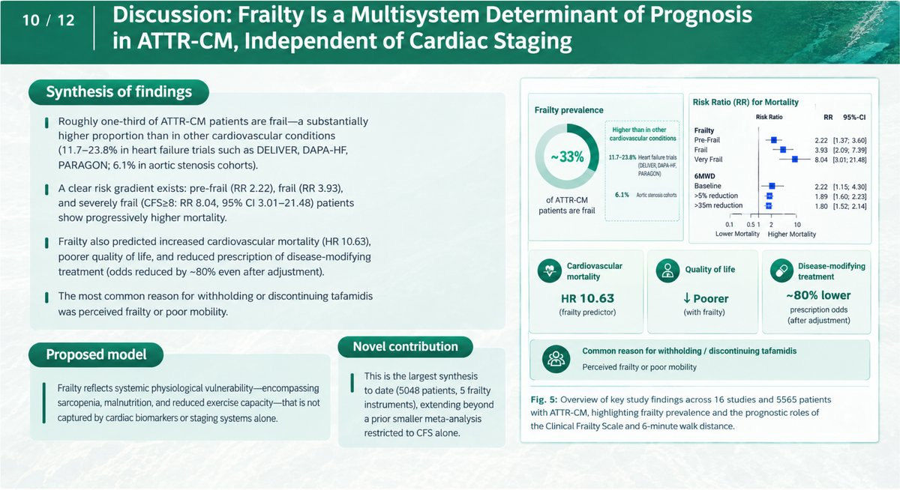
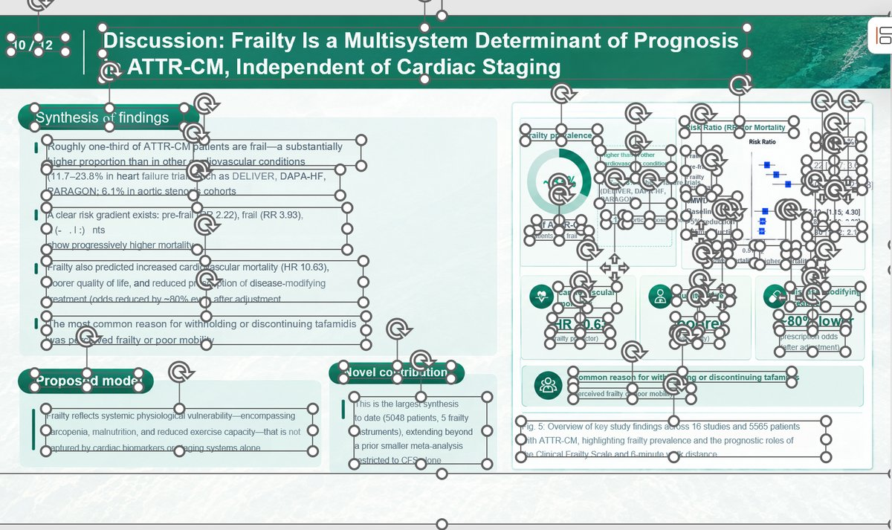

# Editable PPTX Skill

An agent skill for **Claude Code, Codex and other `SKILL.md`-compatible agents** that turns
image-based slides into an **editable PowerPoint (.pptx)**: real text boxes, shapes and
pictures on separate layers, instead of one flat picture per slide.

Typical inputs:

- a slide deck exported as an image-only **PDF** (for example a NotebookLM / Gemini Notebook slide deck);
- **screenshots** of slides;
- slides generated by image models (ChatGPT / GPT Image, Nano Banana / Gemini);
- any ordered set of **PNG, JPG or WebP** slide images (one image becomes one slide).

The skill calls the [Reslide](https://reslide.tosea.ai) REST API by [Tosea](https://tosea.ai).
New accounts get **10 free pages**; after that, 1 page = 1 credit.

| Input: flat slide image | Output: editable PPTX opened in PowerPoint |
| --- | --- |
|  |  |

## Install

### Claude Code: plugin marketplace

```text
/plugin marketplace add ToseaAI/editable-pptx-skill
/plugin install editable-pptx@tosea-skills
```

### Claude Code: copy the folder

```bash
git clone https://github.com/ToseaAI/editable-pptx-skill.git
mkdir -p ~/.claude/skills
cp -r editable-pptx-skill/skills/pptx-convert ~/.claude/skills/
```

Use `.claude/skills/` inside a project instead of `~/.claude/skills/` to scope it to that project.

### Codex and other agents

If your agent reads `SKILL.md` skills, copy `skills/pptx-convert` into its skills directory
(for Codex CLI: `~/.codex/skills/`). Otherwise, add the contents of
[`skills/pptx-convert/SKILL.md`](skills/pptx-convert/SKILL.md) to the agent's instructions and keep
`scripts/convert.py` somewhere the agent can run it.

## Set up an API key

1. Sign in at <https://reslide.tosea.ai> and create a key at <https://reslide.tosea.ai/keys>.
2. Export it in the shell your agent runs in:

   ```bash
   export TOSEA_PPTX_API_KEY=tpx_live_...
   ```

Do not paste the key into the chat. The skill tells the agent never to print, log or commit it.

## Use it

Ask in plain language:

- "Make `notebooklm-deck.pdf` an editable PowerPoint."
- "These six screenshots are my slides. Turn them into one editable pptx, in this order."
- "Turn these Nano Banana slide images into an editable deck called `q3-review.pptx`."

Or run the script directly (Python 3.8+, standard library only, no `pip install`):

```bash
python skills/pptx-convert/scripts/convert.py deck.pdf --out deck.pptx
python skills/pptx-convert/scripts/convert.py slide1.png slide2.png slide3.png
python skills/pptx-convert/scripts/convert.py --pdf-url https://example.com/deck.pdf
```

The script uploads the files, creates the task, polls until it finishes and saves the `.pptx`.
The saved path is the only line printed to stdout. Re-running the same job reuses the existing task
instead of charging twice. See [`SKILL.md`](skills/pptx-convert/SKILL.md) for every option and error code.

## Limits and billing

Checked against the service on 2026-11-02; query `GET /v1/limits` for the current values.

- Inputs: PDF, PNG, JPG/JPEG, WebP. Default limits: 100 MB per upload, 100 pages per task.
- 1 credit per selected PDF page or source image. Credits are reserved when the task starts and
  settle only on success; failed or canceled tasks cost nothing.
- Free: 10 pages, one time. Paid plans start at $19/month for 300 pages
  ([pricing](https://reslide.tosea.ai/#pricing)).
- The download link for a finished deck is valid for 24 hours.

## What to expect

This is a reconstruction from pixels. Text, shapes and images become editable, but anything that is
not visible in the input (speaker notes, animations, links, chart data, original fonts) cannot be
recovered. Check small text, numbers, charts, tables and formulas before you send the deck on.

## No API key? Use the web tools

- [NotebookLM slides to PowerPoint](https://tosea.ai/free-tools/notebooklm-slides-to-powerpoint)
- [Image to editable PPT](https://tosea.ai/free-tools/image-to-editable-ppt)
- [PDF to PPT converter](https://tosea.ai/free-tools/pdf-to-ppt)
- [Reslide web workspace](https://reslide.tosea.ai/workspace)

## Related

- [awesome-html-slide-skills](https://github.com/ToseaAI/awesome-html-slide-skills): a curated list of
  skills that generate HTML slide decks with coding agents.
- [Reslide API reference](https://reslide.tosea.ai/docs) and [OpenAPI document](https://reslideapi.tosea.ai/openapi.json).

## License

[MIT](LICENSE)
